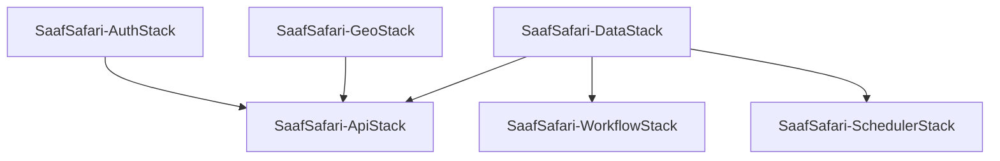

# Phase 5 Research: Backend Deployment & Integration Verification

## 1. Executive Summary & Deployment Landscape
Phase 5 transitions the complete SaafSafari backend from local unit/integration tests to 100% operational deployment on AWS in `ap-south-1` (Mumbai). In accordance with the **Backend-First Development Sequence (DEC-11)**, this deployment and its end-to-end integration test suite must be fully verified and approved prior to initializing any frontend web or mobile client codebases in Milestone 2.

## 2. Infrastructure Inventory & AWS Stack Dependencies
The SaafSafari backend consists of 6 modular CDK stacks defined in `infra/lib/` and wired in `infra/bin/app.ts`:

| Stack Identifier | AWS Resources Provisioned | Key Exports / Outputs |
|---|---|---|
| `SaafSafari-DataStack` | DynamoDB Table (`SaafSafariMain`) with PAY_PER_REQUEST, GSI1, GSI2, TTL;<br>S3 Bucket (`saafsafari-proofs-*`) with SSE-S3 encryption and CORS | `TableNameOutput` (`SaafSafariMain`)<br>`ProofsBucketNameOutput` |
| `SaafSafari-AuthStack` | Cognito User Pool (`saafsafari-user-pool`) with Email OTP / passwordless auth;<br>Cognito Client (`saafsafari-client`);<br>4 User Groups (`citizen`, `collector`, `ward_admin`, `merchant`) | `UserPoolIdOutput`<br>`UserPoolClientIdOutput`<br>`UserPoolArnOutput` |
| `SaafSafari-GeoStack` | Amazon Location Service Map (`saafsafari-map`), Geofence Collection (`saafsafari-geofences`), Tracker (`saafsafari-truck-tracker`) | `MapNameOutput`<br>`GeofenceCollectionNameOutput`<br>`TrackerNameOutput` |
| `SaafSafari-ApiStack` | HTTP API Gateway v2 with Cognito JWT Authorizer;<br>19 TypeScript Lambda functions bundled via esbuild;<br>Routes for onboarding, me, tasks, scans, wallet, coupons, trucks, submissions, hotspots, admin | `HttpApiUrlOutput`<br>`HttpApiIdOutput` |
| `SaafSafari-WorkflowStack` | Step Functions State Machine (`saafsafari-ai-verification`);<br>Evaluation Lambda with Rekognition and Bedrock Nova Lite IAM grants | `StateMachineArnOutput` |
| `SaafSafari-SchedulerStack` | EventBridge Rule (`saafsafari-nightly-health-decay`) on `cron(0 0 * * ? *)`;<br>Nightly Decay Lambda applying 3% decay across 68 territories | `NightlyDecayRuleArnOutput` |

### Explicit Dependency Tree


## 3. Key Technical Findings
1. **CDK Bootstrap Status:**
   - Active AWS Account: `517025126295` (caller identity: root).
   - Target Region: `ap-south-1` (Mumbai).
   - Status: `CDKToolkit` is not yet bootstrapped in `ap-south-1`.
   - Action: Plan 05-01 must execute `cdk bootstrap aws://517025126295/ap-south-1` prior to stack deployment.
2. **Bedrock Foundation Model Availability in Mumbai (`ap-south-1`):**
   - Verified via AWS CLI: `amazon.nova-lite-v1:0` is directly available in `ap-south-1`.
   - No cross-region inference profile or VPC peering is necessary; evaluation Lambda executes directly against `bedrock-runtime` in `ap-south-1`.
3. **Lambda Packaging & Asset Bundling:**
   - CDK synth successfully bundles all 21 TypeScript Lambda functions using esbuild in < 200 ms per function.
   - All Lambda handlers import workspace dependencies (`@saafsafari/shared`, `@saafsafari/game-rules`) cleanly via zero-build source exports.

## 4. Environment Configuration & Export Strategy
To bridge the CDK deployment outputs with local test harnesses, web apps, and mobile apps, a dedicated exporter script `scripts/export-env.ts` will process `cdk-outputs.json`:

```typescript
// scripts/export-env.ts structure
// 1. Reads cdk-outputs.json generated by `cdk deploy --all --outputs-file cdk-outputs.json`
// 2. Extracts:
//    - API_URL from SaafSafari-ApiStack.HttpApiUrlOutput
//    - COGNITO_USER_POOL_ID & CLIENT_ID from SaafSafari-AuthStack
//    - TABLE_NAME & PROOFS_BUCKET_NAME from SaafSafari-DataStack
//    - STATE_MACHINE_ARN from SaafSafari-WorkflowStack
//    - LOCATION_* from SaafSafari-GeoStack
// 3. Generates:
//    - Root `.env`
//    - `services/api/.env`
//    - `apps/web/.env` (prepares for Phase 6)
//    - `apps/mobile/.env` (prepares for Phase 7)
```

## 5. Live Database Seeding on AWS
- The seed script `scripts/seed.ts` is already written and tested with 100% test coverage (`scripts/test/seed.test.ts`).
- It generates 158 total items:
  - 68 Delhi NCR H3 res-7 territories with mascots and initial health (45-88).
  - 40 QR sources (25 smart bins, 10 trucks, 5 e-waste hubs).
  - 10 local merchants (e.g., Blue Tokai, Chaayos, FabIndia).
  - 15 coupons with weekly redemption limits and credit costs.
  - 10 mock users and initial ledger transactions.
- Running `TABLE_NAME=SaafSafariMain AWS_REGION=ap-south-1 pnpm seed` writes the entire dataset into live DynamoDB in ~2 seconds using batch writes.

## 6. End-to-End Live Integration Test Architecture
A dedicated Vitest integration test suite `services/api/test/integration/live-e2e.test.ts` will run against the live API Gateway endpoint.

### Ephemeral Cognito Auth Helper
Using `@aws-sdk/client-cognito-identity-provider`:
- `createTestUser(email, password, group)`:
  - Calls `AdminCreateUserCommand` with `MessageAction: 'SUPPRESS'`.
  - Calls `AdminSetUserPasswordCommand` (`Permanent: true`).
  - Calls `AdminAddUserToGroupCommand` (`GroupName: 'citizen'` or `'ward_admin'`).
  - Calls `AdminInitiateAuthCommand` (`AuthFlow: 'ADMIN_NO_SRP_AUTH'`).
  - Returns `idToken`, `accessToken`, and `userId`.
- `deleteTestUser(username)`:
  - Calls `AdminDeleteUserCommand` to ensure zero test user pollution.

### Test Scenarios Matrix
1. **User Onboarding & Profile (`AUTH-01`)**:
   - `POST /v1/onboarding/complete` -> `GET /v1/me`.
2. **Tasks & Habit Checkin**:
   - `GET /v1/tasks` -> `POST /v1/tasks/checkin`.
3. **Static QR Code Verification (`QR-01`, `CRED-02`)**:
   - Compute HMAC signature for `qr_bin_cp_inner_circle_01`.
   - `POST /v1/scans` -> verify credit award (+15 GC, +35 XP).
   - DynamoDB direct query verifies `LEDGER#<txId>` record exists.
4. **Rotating Collector QR Verification (`QR-02`)**:
   - Generate rotating HMAC token with 30s timestamp window.
   - `POST /v1/scans` -> verify dual credit distribution to citizen and collector.
5. **Wallet & Coupon Redemption (`WALT-01`, `WALT-02`)**:
   - `GET /v1/wallet` -> verify positive balance.
   - `GET /v1/coupons` -> select `coup_blue_tokai_50_off`.
   - `POST /v1/coupons/redeem` -> verify voucher code generated and GC deducted.
6. **S3 Proof Upload & Multimodal AI Verification (`AI-01`, `AI-02`)**:
   - `POST /v1/submissions` -> receive presigned PUT URL.
   - Native HTTP `PUT` uploads test image buffer to S3.
   - Step Functions state machine execution verifies Rekognition + Bedrock Nova Lite processing.
7. **Civic Hotspot Reporting (`HOT-01`, `HOT-02`)**:
   - `POST /v1/hotspots` -> verify -5 territory health deduction and auto-generated bounty.
8. **Municipal Admin & Cedar Guard (`ADM-01`, `ADM-02`, `ADM-03`)**:
   - Elevate test user to `ward_admin`.
   - `GET /v1/admin/territory-overview` -> verify 68 territories returned.
   - `POST /v1/admin/qr-sources` -> create new municipal QR source.
   - `GET /v1/admin/review-queue` -> inspect flagged submissions.
   - `POST /v1/admin/review-queue/resolve` -> resolve submission with Cedar authorization.
