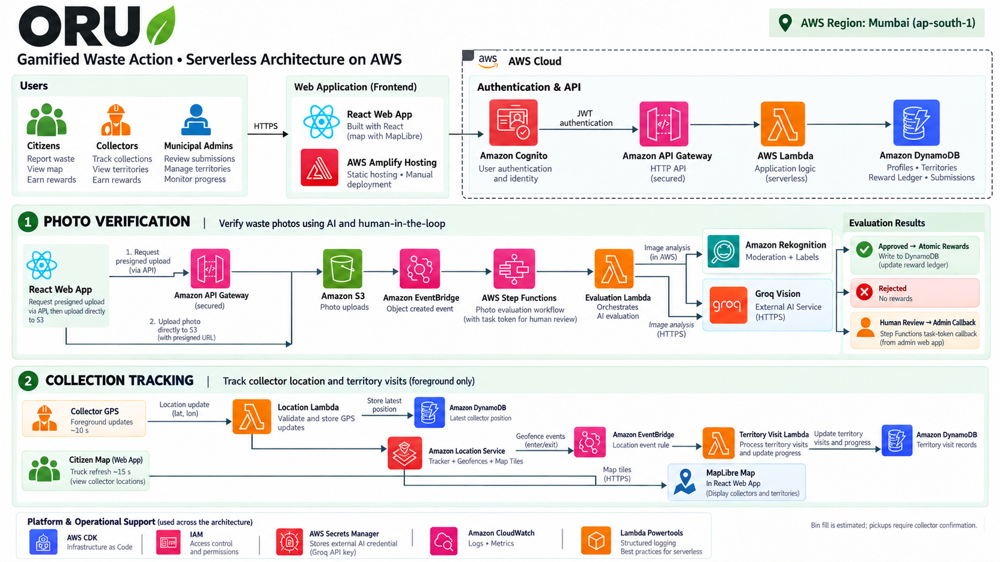
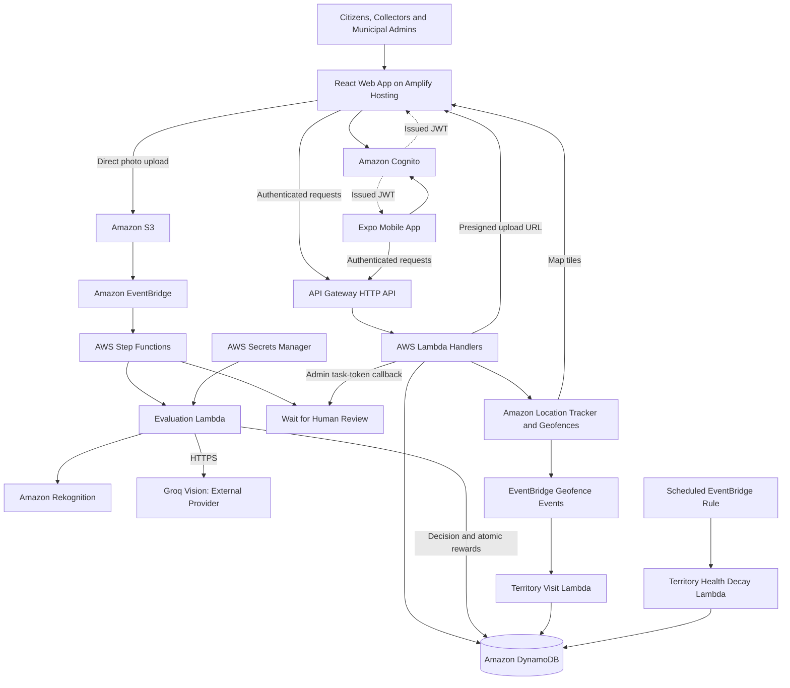

<p align="center">
  <a href="https://main.d2yv74n1dn7go4.amplifyapp.com">
    
  </a>
</p>

<h1 align="center">Oru</h1>

<p align="center">A shared neighborhood world powered by everyday waste actions.</p>

<p align="center">
  <a href="https://main.d2yv74n1dn7go4.amplifyapp.com">Live Application</a> &middot;
  <a href="#architecture">Architecture</a> &middot;
  <a href="#getting-started">Getting Started</a> &middot;
  <a href="docs/12-AWS-DEPLOYMENT.md">Deployment Guide</a>
</p>

## Overview

Oru connects citizens, waste collectors and municipal teams through verified participation, neighborhood guardians and a shared geographic map. Citizens earn Green Credits and XP for supported actions, collectors share their location and confirm pickups, and administrators review evidence and monitor territory activity.

Built for the Waste and Energy track of Environmental Hacks by WeMakeDevs and AWS, Oru combines a React web application, an Expo mobile application and a serverless backend deployed in AWS Mumbai (`ap-south-1`).

The project is a deployed prototype. Its territory-health score measures participation within Oru, not environmental quality. Seeded locations and registered trucks are demonstration data rather than evidence of a municipal fleet rollout.

## Features

| Audience | Capabilities |
| --- | --- |
| Citizens | Signed QR scans, photo submissions, waste hotspot reporting, bin issue reports, tasks, rewards, coupons and leaderboards |
| Collectors | Rotating handover QR codes, foreground GPS sharing and explicit nearby pickup confirmation |
| Municipal administrators | Territory summaries, photo review queue, QR-source management and geofence synchronization |
| Shared neighborhood experience | H3 territories, health-based guardian artwork, collection points, truck positions and recorded routes |

The production website includes English and Hindi translations, responsive layouts, reduced-motion support and a list alternative when the geographic map cannot render.

## Architecture



The illustration provides a high-level overview. The flows below specify how authentication, uploads and asynchronous processing connect in the implementation.



### Authentication and API Access

Amazon Cognito authenticates users. API Gateway validates JWTs for protected routes, and Lambda handlers independently enforce role permissions for collector and administrator operations. The web client currently holds tokens in memory; refreshing the page requires signing in again.

### QR Verification and Rewards

The scan handler validates the request, loads the registered source, checks its active status and verifies its signed static payload or rotating collector token. Location checks and a four-hour per-source cooldown reduce simple replay abuse.

For collector scans, the current implementation uses a recent collector position when available and falls back to the registered position otherwise. Browser GPS and QR possession are supporting signals, not conclusive proof of a physical handover.

Reward processing uses DynamoDB transactions to update the action ledger, user balances, cooldown and territory activity together. A conditional cooldown write prevents parallel requests from independently rewarding the same cooldown window. Reward calculations live in the shared game-rules package.

### Photo Verification and Human Review

1. An authenticated client creates a submission and receives a presigned S3 upload URL.
2. The client uploads its photo directly to the private evidence bucket.
3. An S3 object-created event reaches EventBridge and starts Step Functions.
4. The evaluation Lambda checks submission state, image size and an exact-byte SHA-256 fingerprint.
5. Amazon Rekognition provides moderation screening and image labels.
6. Groq assesses visible evidence of the claimed action. Its credential is retrieved server-side from Secrets Manager.
7. A validated decision leads to rejection, human review or an atomic approval-and-reward transaction.

The evaluator currently accepts images up to 5 MB. Automatic approval requires a positive evidence decision and a score of at least `0.75`; positive decisions between `0.35` and `0.75` go to review. Negative decisions and scores below `0.35` are rejected. Service failures and invalid model output go to review, and automatic photo approvals are capped at three per user per application day.

Model scores are decision signals, not calibrated probabilities that a real-world action occurred. Exact-byte fingerprints do not detect every cropped, edited or re-encoded duplicate.

Flagged submissions pause using a Step Functions task token. A municipal decision resumes the workflow through the administrator API. The review task has a seven-day timeout. Rejection is a completed business outcome rather than a failed workflow execution.

### Maps and Collection Tracking

H3 cells define neighborhood territories. MapLibre renders their boundaries over Amazon Location map tiles. The map combines guardians, collection points, reported hotspots and truck positions.

Collectors explicitly start foreground GPS sharing. Updates approximately every ten seconds write the latest position to DynamoDB and send coordinates to Amazon Location Tracker. Linked geofences produce entry and exit events through EventBridge, which a Lambda handler records as territory visits. The citizen map refreshes truck positions approximately every 15 seconds; a selected truck's route comes from recorded location history.

Bin fill is an uncalibrated estimate, including a configured increase of approximately 2.5 percentage points per hour since pickup. Citizen reports can mark a bin full. Only explicit nearby collector confirmation resets it; truck proximity alone does not imply pickup. Damage persists until repair confirmation.

## Technology Stack

| Layer | Technologies |
| --- | --- |
| Production web | React 18, TypeScript, Vite, React Router, Tailwind CSS, i18next, Framer Motion |
| Mobile | React Native, Expo, React Navigation, camera and location integrations |
| Mapping and QR | MapLibre GL JS, H3, ZXing, QR generation |
| Backend | TypeScript, AWS Lambda, AWS SDK for JavaScript v3, shared validation schemas |
| Data and evidence | Amazon DynamoDB, Amazon S3 |
| Identity and access | Amazon Cognito, API Gateway JWT authorizer, IAM |
| Asynchronous workflows | Amazon EventBridge, AWS Step Functions |
| Image assessment | Amazon Rekognition and external Groq vision assessment |
| Geography | Amazon Location Maps, Tracker and Geofences |
| Operations | Secrets Manager, CloudWatch, Lambda Powertools logging |
| Infrastructure and hosting | AWS CDK, CloudFormation, Amplify Hosting |
| Verification | Vitest, React Testing Library, CDK assertions and browser checks |

Amazon Bedrock was explored during development; it is not the current deployed visual-assessment provider.

## Repository Structure

```text
Oru/
  frontend/                 Production website and authenticated web application
  apps/
    mobile/                 Expo citizen and collector application
    web/                    Earlier web prototype retained for reference
  services/api/             Lambda handlers, backend utilities and tests
  packages/
    shared/                 Shared schemas and domain types
    game-rules/             Reward and progression calculations
  infra/                    AWS CDK stacks and infrastructure tests
  scripts/                  Configuration export, seeding and development utilities
  docs/                     Architecture, integration and deployment documentation
```

Some internal package and resource names retain the earlier `SaafSafari` name. The public product is Oru.

## Getting Started

### Requirements

- Node.js 22 or later.
- pnpm 10.12.1, as declared by the repository.
- AWS credentials with appropriate permissions when deploying infrastructure.
- A configured Cognito client and API endpoint for authenticated features.

### Run the Web Application

```bash
git clone https://github.com/Joohhnnyyy/Oru.git
cd Oru
pnpm install
pnpm --filter @saafsafari/shared build
pnpm --filter @saafsafari/game-rules build
pnpm --filter web dev
```

Use the local address printed by Vite. Public pages can run without backend configuration; authenticated features require the following public client settings in `frontend/.env.local`:

```dotenv
VITE_API_URL=https://your-api.execute-api.ap-south-1.amazonaws.com/
VITE_COGNITO_CLIENT_ID=your-cognito-client-id
VITE_COGNITO_REGION=ap-south-1
VITE_SITE_URL=http://localhost:5173
VITE_SOURCE_URL=https://github.com/Joohhnnyyy/Oru
```

See [the configuration template](frontend/.env.example) for additional settings. Every `VITE_*` value is public browser configuration. Never place AWS credentials, signing secrets or AI-provider keys in frontend variables.

If a backend deployment has generated root-level `cdk-outputs.json`, export its public settings with:

```bash
pnpm export-env --frontend-only
```

### Run the Mobile Application

```bash
pnpm --filter @saafsafari/mobile start
```

Configure the mobile application's API and Cognito settings for your environment before testing authenticated workflows. Consult [the mobile integration notes](apps/mobile/README-DEMO.md), noting that older provider descriptions there may predate the current Groq workflow.

Camera and location features require device permissions. Browser camera and GPS access require HTTPS or localhost.

## Build and Verification

```bash
# Production website
pnpm --filter web build
pnpm --filter web preview
pnpm --filter web test
pnpm --filter web typecheck

# Backend unit tests, without the live AWS integration suite
pnpm --filter @saafsafari/api exec vitest run --exclude 'test/integration/**'
pnpm --filter @saafsafari/api typecheck

# Infrastructure assertions
pnpm --filter @saafsafari/infra test

# Mobile type checking
pnpm --filter @saafsafari/mobile typecheck
```

The most recent checks in this working session passed 73 frontend tests, 128 backend unit tests and six infrastructure tests. The live integration suite could not connect to Cognito from the restricted execution environment; those results do not constitute a fresh live end-to-end pass.

Live integration tests require AWS access and can create test users and application records. Review their setup and target environment before running `pnpm test:integration`.

## Deployment

### Backend

CDK defines six stacks: Data, Auth, Geo, API, Workflow and Scheduler. The root deployment command currently targets the existing Mumbai deployment and account; review `package.json` and the infrastructure configuration before using it for another account.

```bash
pnpm deploy:backend
pnpm export-env --frontend-only
```

The photo evaluator expects its Groq credential in Secrets Manager under the configured secret name, currently `oru/groq-api-key`. Provision it securely before enabling that workflow.

### Frontend

The existing Amplify deployment was published manually from `frontend/dist`. Automatic Git deployments are not currently configured. The repository includes `amplify.yml` for a future connected build setup.

```bash
pnpm --filter web build
```

Publish the contents of `frontend/dist` to the configured Amplify application. See [deployment instructions](docs/12-AWS-DEPLOYMENT.md) for the current process.

| Deployment | Address |
| --- | --- |
| Web application | https://main.d2yv74n1dn7go4.amplifyapp.com |
| Backend API base | https://dp029jx9uf.execute-api.ap-south-1.amazonaws.com/ |
| AWS region | `ap-south-1` |

Protected API routes require authentication; the API base URL is not a standalone web interface.

## Application Routes

| Route | Purpose |
| --- | --- |
| `/signin` | Authentication |
| `/onboarding` | Language and location setup |
| `/home` | Citizen dashboard |
| `/map` | Territories, collection points, hotspots and trucks |
| `/t/:id` | Territory details and guardian state |
| `/scan` | QR verification |
| `/proof` | Photo upload and submission status |
| `/tasks` | Task progress and habit check-in |
| `/rewards` | Wallet, ledger and coupons |
| `/leaderboard` | Citizen and territory rankings |
| `/community` | Local issues and reports |
| `/profile` | Profile and language preference |
| `/collector` | Collector QR and location sharing |
| `/console` | Municipal overview |
| `/console/review` | Photo review queue |
| `/console/qr-sources` | Collection-source management |

## Security and Operational Boundaries

- Backend handlers enforce roles independently of frontend navigation.
- Photo evidence uses a private S3 bucket, presigned uploads and encrypted transport.
- Provider credentials remain server-side in Secrets Manager.
- Conditional writes and transactions protect reward updates and cooldowns.
- Unavailable image assessment routes evidence to review rather than automatic approval.
- Photos are sent to Groq for assessment; user-facing privacy information should describe this external processing.
- Collector browser tracking requires an open foreground page and location permission.
- Current infrastructure has prototype-oriented destructive removal settings, and DynamoDB point-in-time recovery is disabled. Review retention and enable recovery before a real operational rollout.

## Current Scope and Next Steps

The deployed demo includes 61 territories, 36 collection points and ten registered trucks. Geographic deployment checks did not connect physical truck GPS hardware or bin sensors. Reward balances and guardian health are application state, not independently verified environmental impact.

Priorities for a wider pilot include calibrated photo-evaluation datasets, perceptual duplicate detection, reliable background collector tracking, measured bin-fill calibration, automated deployments and stronger backup and operational monitoring policies.

## Documentation

- [Frontend implementation](frontend/README.md)
- [Frontend and backend integration](docs/10-FRONTEND-BACKEND-INTEGRATION.md)
- [City map and collection tracking](docs/11-CITY-MAP.md)
- [AWS deployment record](docs/12-AWS-DEPLOYMENT.md)
- [Architecture image](docs/design/oru-architecture-hd.png)

## Contributions

Contributions should keep changes focused, use the existing shared schemas and reward rules, and include verification appropriate to the affected behavior. Describe the user-facing change and relevant checks when opening a pull request. Do not commit credentials, local environment files or private evidence.
